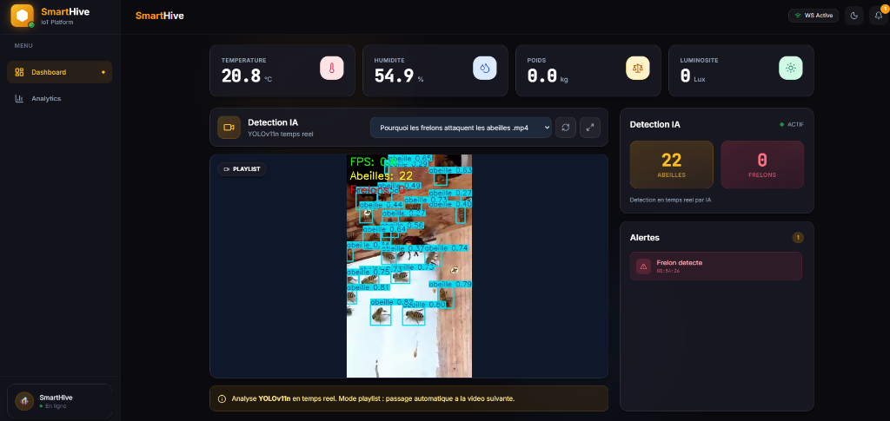

# SmartHive — Ruche connectée IoT & Vision par ordinateur

[](https://www.python.org/downloads/)
[](https://kit.svelte.dev/)
[](https://github.com/ultralytics/ultralytics)

Prototype pédagogique de surveillance de ruche développé au FabLab Valrose (Université Côte d'Azur) : télémétrie environnementale LoRaWAN et détection vidéo d'abeilles et de frelons asiatiques en temps réel.

## Galerie

<table>
  <tr>
    <th>Prototype matériel</th>
    <th>Interface temps réel</th>
  </tr>
  <tr>
    <td>
      
    </td>
    <td>
      
    </td>
  </tr>
  <tr>
    <td align="center">Ruche instrumentée et boîtier de capteurs</td>
    <td align="center">Détection vidéo et remontée capteurs</td>
  </tr>
</table>

## Fonctionnalités

- **Détection abeilles / frelons** : modèle YOLOv11n entraîné sur le jeu public [Bee-Hornet-Detect](https://universe.roboflow.com/imgprocess-n3bpn/bee-hornet-detect) et exporté en **NCNN** / **TFLite INT8** (~5 FPS sur Raspberry Pi 4 en 320 px).
- **Télémétrie LoRaWAN** : capteurs embarqués (température, humidité, luminosité, masse), envoi via The Things Network et collecte MQTT.
- **Dashboard temps réel** : flux vidéo MJPEG annoté, comptage des détections, alertes et suivi des capteurs.

## Architecture

1. **Capteurs (Ruche)** : acquisition et envoi des mesures via LoRaWAN.
2. **Backend (`backend/`)** : API FastAPI, réception MQTT, stockage et diffusion WebSocket.
3. **Serveur Vision (`ai-vision/`)** : inférence YOLO/NCNN locale et envoi des comptages au backend.
4. **Frontend (`frontend/`)** : interface SvelteKit + TailwindCSS + Chart.js.

## Démarrage local

### Pré-requis
- Python 3.9+
- Node.js 18+

### 1. Backend (API)
```bash
cd backend
pip install -r requirements.txt
python main.py
# API sur http://localhost:2000
```

### 2. Frontend (Dashboard)
```bash
cd frontend
npm install
npm run dev -- --port 2001
# Interface sur http://localhost:2001
```

### 3. Serveur Vision
```bash
cd ai-vision
pip install -r requirements.txt
python video_server.py
# Flux vidéo sur http://localhost:2002/video_feed
```

## Pistes d'évolution

- **Déclenchement acoustique** : utiliser l'analyse fréquentielle pour réveiller la caméra uniquement lors d'activité ou de signature frelon, afin d'économiser la batterie.
- **Migration matérielle** : passage progressif vers une architecture basse consommation pour gagner en autonomie sur le terrain.

## Crédits

- **Mathis Steinmann** : développement fullstack, intégration IoT, entraînement et export des modèles de vision.
- **Didier Orlandi** : enseignant FabLab & initiateur du projet, supervision technique Hardware / IoT.
